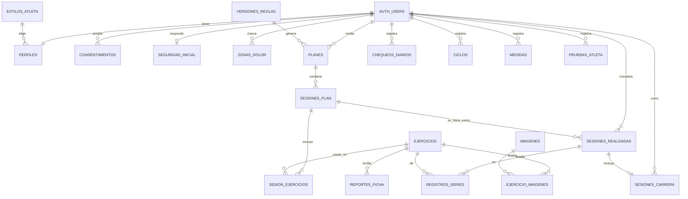

# Modelo de datos

> Diseño en papel de **todas** las tablas, aunque se creen en fases distintas.
> Fuentes: sección 10, 14 y 18 del *Estudio de entrenamiento por casos* y la migración
> `0001_inicio.sql` del *Plan técnico fases 0 y 1*. Base de datos: Supabase (Postgres).

## Convenciones

- Nombres en español, `snake_case`, tablas en plural.
- `usuario_id uuid` referencia `auth.users(id) on delete cascade`: **al borrar la cuenta se borra todo**.
- Fechas en `timestamptz`; columnas `creado_en` y, si se editan, `actualizado_en`.
- Textos visibles con versión en inglés (`nombre_en`, `texto_en`) para traducir después.
- **RLS activado en todas las tablas**, sin excepción.

**Leyenda de sensibilidad**
- 🔴 **Sensible (salud):** requiere consentimiento expreso de datos de salud, es opcional y se puede borrar.
- 🟡 **Personal:** dato de la usuaria, solo ella lo ve.
- 🟢 **Público / catálogo:** lo leen todas; nadie lo escribe desde la app.
- ⚙️ **Sistema:** solo la API con clave secreta.

## Diagrama

## Tablas

### 1. Cuenta y consentimiento — Fase 1 y 2

#### `perfiles` 🟡 · Fase 1
| Campo | Tipo | Notas |
|---|---|---|
| id | uuid PK | = `auth.users.id` |
| nombre | text | |
| fecha_nacimiento | date | Calcula la edad; regla de 18 años |
| sexo | text | `mujer`, `hombre`, `prefiero_no_decir` |
| lugar | text | `casa`, `gym`, `ambos` |
| equipo | text[] | nada, tapete, banda, mancuernas, cuerda, silla, cajón |
| experiencia | text | entrena ahora / desde cuándo / hace cuánto lo dejó |
| dias_por_semana | int | 1 a 7 |
| minutos_por_sesion | int | Define cuántos bloques (A, B, C) caben |
| objetivo | text | salud, fuerza, músculo, resistencia, correr |
| estilo_atleta_id | FK → `estilos_atleta` | Opcional |
| fase_actual | text | salud_constancia, ganar_musculo, definir, fuerza, resistencia |
| creado_en / actualizado_en | timestamptz | |

**RLS:** leer, crear y actualizar solo `auth.uid() = id`.

#### `consentimientos` 🟡 · Fase 1
| Campo | Tipo | Notas |
|---|---|---|
| id | bigint PK | |
| usuario_id | uuid FK | |
| tipo | text | `aviso_privacidad`, `datos_salud` |
| version_aviso | text | Qué versión del aviso aceptó |
| aceptado | boolean | Retirar = nueva fila con `false` |
| creado_en | timestamptz | |

**RLS:** leer y crear las propias. **Sin update ni delete**: es un historial.

#### `seguridad_inicial` 🔴 · Fase 2
Respuestas de la parte 1 del cuestionario (sí/no). El motor las usa en `evaluarSeguridad`.
| Campo | Tipo | Notas |
|---|---|---|
| usuario_id | uuid PK/FK | |
| condicion_cardiometabolica | boolean | Corazón, presión alta, diabetes, riñón |
| sintomas_con_esfuerzo | boolean | Dolor de pecho, mareo, desmayo |
| embarazo_o_posparto | boolean | |
| lesion_reciente | boolean | |
| resultado | text | `ok`, `limitar_intensidad`, `solo_caminar`, `consultar_profesional` |
| actualizado_en | timestamptz | |

**RLS:** solo la dueña. Se escribe **solo por la API** (que guarda el resultado del motor).

#### `zonas_dolor` 🔴 · Fase 2
| Campo | Tipo | Notas |
|---|---|---|
| id | bigint PK | |
| usuario_id | uuid FK | |
| zona | text | rodilla, espalda baja, hombro, muñeca… |
| activa | boolean | |
| creado_en | timestamptz | |

**RLS:** solo la dueña.

### 2. Catálogo — Fase 1 y 3

#### `ejercicios` 🟢 · Fase 1
| Campo | Tipo | Notas |
|---|---|---|
| id | bigint PK | |
| nombre / nombre_en | text | |
| familia / patron | text | sentadilla, bisagra, empuje, jalón, core… |
| escala | text | Escala de progresión a la que pertenece |
| nivel | int | 1 a 8 dentro de su escala |
| lugar | text | `casa`, `gym`, `ambos` |
| equipo | text[] | |
| musculos | text[] | |
| impacto | int | 0 a 3 |
| zonas_que_carga | text[] | Para excluir por dolor |
| contraindicaciones | text[] | |
| ficha | jsonb | Posición, pasos, dónde sentirlo, errores, ritmo, versión fácil/difícil, señal para parar |
| fuente | text | Obligatoria y visible |
| activo | boolean | Para ocultar sin borrar |

**RLS:** lectura para `authenticated`. Sin políticas de escritura (se carga con la clave secreta).

#### `imagenes` 🟢 · Fase 3
| Campo | Tipo | Notas |
|---|---|---|
| id | bigint PK | |
| ruta | text | Se resuelve por una función (Supabase Storage → Bunny después) |
| autor | text | |
| licencia | text | |
| fecha | date | |
| autorizacion | text | Si aparece una persona, referencia a su autorización firmada |

#### `ejercicio_imagenes` 🟢 · Fase 3
Relación muchos a muchos: `ejercicio_id`, `imagen_id`, `orden`.

#### `estilos_atleta` 🟢 · Fase 3
| Campo | Tipo | Notas |
|---|---|---|
| id | bigint PK | |
| nombre / nombre_en | text | Velocista, Bailarina/pilates, Calistenia, Corredora de fondo |
| descripcion | text | |
| enfasis | jsonb | Proporción de volumen por patrón |
| activo | boolean | Bandera para encender estilos nuevos |

### 3. Rutinas — Fase 3

#### `versiones_reglas` ⚙️
`id`, `version` (ej. `2026.1`), `notas`, `creado_en`. Cada plan guarda con qué reglas se generó para poder explicarlo y reproducirlo.

#### `planes` 🟡
| Campo | Tipo | Notas |
|---|---|---|
| id | bigint PK | |
| usuario_id | uuid FK | |
| version_reglas_id | FK | |
| division | text | cuerpo completo, superior/inferior… |
| semana_inicio | date | |
| activo | boolean | |

**RLS:** leer la dueña. Escribe **solo la API** (el motor genera el plan).

#### `sesiones_plan` 🟡
`id`, `plan_id`, `semana`, `dia`, `tipo` (fuerza, cardio, movilidad).

#### `sesion_ejercicios` 🟡
| Campo | Tipo | Notas |
|---|---|---|
| id | bigint PK | |
| sesion_plan_id | FK | |
| ejercicio_id | FK | |
| bloque | text | `A`, `B`, `C` |
| orden | int | |
| series | int | |
| reps_min / reps_max | int | O `segundos_min / segundos_max` |
| descanso_seg | int | |

**RLS (las tres):** leer solo si el plan es de la usuaria. Escribe la API.

### 4. Progreso — Fase 2 y 4

#### `chequeos_diarios` 🔴 · Fase 2
La pregunta antes de entrenar.
| Campo | Tipo | Notas |
|---|---|---|
| id | bigint PK | |
| usuario_id | uuid FK | |
| fecha | date | Única por usuaria y día |
| horas_sueno | numeric | |
| como_se_siente | text | `con_energia`, `normal`, `cansada`, `con_molestias` |

**RLS:** solo la dueña. Escribe la API (para aplicar el ajuste del día).

#### `sesiones_realizadas` 🟡 · Fase 4
| Campo | Tipo | Notas |
|---|---|---|
| id | bigint PK | |
| usuario_id | uuid FK | |
| sesion_plan_id | FK | |
| fecha | date | |
| bloques_completados | text[] | `{A}` ya cuenta como día completo |
| version_reglas_id | FK | |

#### `registros_series` 🔴 · Fase 4
| Campo | Tipo | Notas |
|---|---|---|
| id | bigint PK | |
| sesion_realizada_id | FK | |
| ejercicio_id | FK | |
| serie | int | |
| repeticiones / segundos | int | |
| reserva | int | Repeticiones en reserva (no se usa para progresar las 2 primeras semanas) |
| dolor | boolean | Si es `true`, se ofrece alternativa |
| carga_kg | numeric | Solo gym |

**RLS:** solo la dueña (vía la sesión). Escribe la API.

### 5. Datos opcionales de salud — Fase 2 (ciclo) y versión B

Todas 🔴, **apagadas por defecto**, con botón para borrar todo.

#### `ciclos` 🔴
`id`, `usuario_id`, `fecha_inicio`, `duracion_dias`, `regular` (boolean), `sintomas` (text[]).

#### `medidas` 🔴
`id`, `usuario_id`, `fecha`, `peso_kg`, `hombros`, `pecho`, `brazo`, `cintura`, `cadera`, `muslo`, `pantorrilla` (todas opcionales, en cm). Se muestran como tendencia, nunca comparadas.

#### `pruebas_atleta` 🟡
`id`, `usuario_id`, `fecha`, `tipo` (lagartijas, plancha_seg, salto_longitud_cm, trote_min), `valor`. Aquí se abren los pétalos de la flor.

**RLS (las tres):** CRUD solo la dueña. Las fotos **no** se guardan en el servidor en el MVP.

### 6. Operación y métricas — Fase 6

#### `reportes_ficha` 🟡
`id`, `usuario_id`, `ejercicio_id`, `motivo` (`no_entendi`, `dolor`), `creado_en`. Si una ficha acumula reportes, se reescribe.

#### `lista_espera` ⚙️
`id`, `correo`, `creado_en`, `invitado_en`. Sin lectura desde la app.

#### `configuracion` ⚙️
`clave`, `valor` (ej. `max_cuentas_activas`, banderas de funciones). Solo la API.

**Panel admin:** usa **vistas con totales** (sesiones por semana, retención, % con dolor). Nunca lee filas individuales de salud.

## Resumen de RLS

| Tabla | Leer | Escribir |
|---|---|---|
| perfiles | dueña | dueña |
| consentimientos | dueña | dueña (solo insertar) |
| seguridad_inicial, chequeos_diarios | dueña | API |
| zonas_dolor, ciclos, medidas, pruebas_atleta | dueña | dueña |
| planes, sesiones_plan, sesion_ejercicios | dueña | API |
| sesiones_realizadas, registros_series, sesiones_carrera | dueña | API |
| ejercicios, imagenes, estilos_atleta | todas (autenticadas) | nadie desde la app |
| reportes_ficha | dueña | dueña (solo insertar) |
| versiones_reglas, lista_espera, configuracion | nadie desde la app | API |

**Prueba obligatoria por tabla:** iniciar sesión como usuaria A e intentar leer y escribir datos de la usuaria B. Debe fallar.

## Decisiones aplicadas (issue #5)

- **Peso y estatura:** entran al MVP en `medidas`, opcionales y apagados por defecto.
- **Cardio completo en el MVP:** se agrega `sesiones_carrera` (abajo) para aplicar la regla del 10%.
- **Hipopresivos:** no requieren tabla nueva; son ejercicios del catálogo con `contraindicaciones` = presión alta, condición cardiometabólica, embarazo/posparto.
- **Gym:** el campo `equipo` de `ejercicios` usa: mancuernas, barra, discos, poleas, máquinas.

#### `sesiones_carrera` 🟡 · Fase 4
| Campo | Tipo | Notas |
|---|---|---|
| id | bigint PK | |
| usuario_id | uuid FK | |
| sesion_realizada_id | FK | Opcional, si fue parte de una sesión del plan |
| fecha | date | |
| tipo | text | `caminata`, `intervalos`, `trote`, `cuerda` |
| duracion_min | numeric | Base de la regla: ≤ 110% de la más larga del último mes |
| distancia_km | numeric | Opcional |
| intervalos | jsonb | Ej. `[{trote: 1, camina: 2}, ...]` |

**RLS:** leer la dueña; escribe la API (valida la regla del 10% con el motor).
